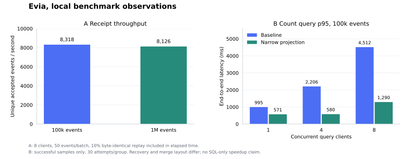
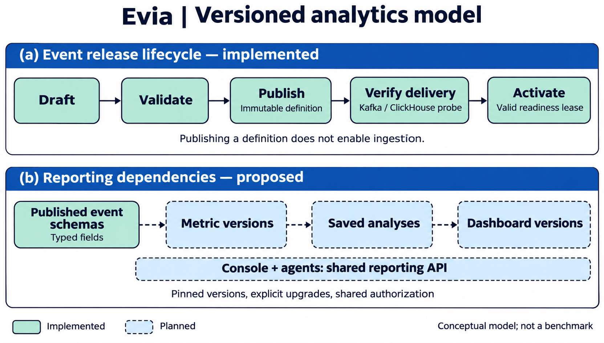

# Evia 映途

私有化事件采集与用户行为分析平台。以业务事件定义、稳定用户身份和可解释的分析口径，把页面访问、阅读和互动连接起来。

当前已实现会话与项目管理、事件定义、来源管理、Redis 配额、Kafka 到 ClickHouse 写入，以及真实管道验证后的发布激活和公开配置。分析支持受权字段发现、固定事件版本、有界指标/趋势/行为链/有序漏斗查询，以及可编辑、校验、发布和按版本运行的[保存分析](docs/saved-analyses.md)。

控制台使用自建原生组件，提供结构化编辑、多指标图表和完整结果表。模块按编辑、发布、执行和结果职责拆分，依赖边界与运行时循环检查进入 CI。完整浏览器回归 **38 项通过**，模块与交互规范见[前端职责说明](docs/standards/frontend-modules.md)。

真实压测完成十万、百万事件上报和存储核对，修复缓存到期误拒绝并减少趋势查询读取列；**百万条全量查询仍受默认资源预算限制**。数据规模、失败记录、恢复操作和复现方法见[压测与工程整理](docs/verification/load-and-maintainability-2026-11-08.md)。自定义看板、独立指标注册、机器令牌和浏览器 SDK 等仍待交付，完整状态见 [PROGRESS.md](PROGRESS.md)。

<details>
<summary>查看保存分析界面</summary>


使用合成事件，经真实 API 与查询工作进程生成结果。[移动端截图](docs/assets/saved-analysis-mobile.png) 展示相同版本和数据，表格可在自身区域横向滚动。

</details>

历次真实依赖、公开 HTTP 和浏览器验证保存在[开发进度](PROGRESS.md)及其关联记录中。当前结果不构成千万用户容量或生产就绪声明。

<details>
<summary>查看本轮压测观测</summary>



图表由[实际报告数据](docs/verification/data/load-2026-11-08.json)绘制。查询延迟只统计成功样本，前后分片布局与恢复状态不同，不能视为仅改变 SQL 的受控性能实验。

</details>

## 架构概览


图 1，平台逻辑链路。实线框表示已实现模块，虚线框表示规划模块；重复出现的数据库表示同一存储职责，图中分层不代表独立部署实例。容量目标及验证边界见 [架构说明](docs/architecture.md) 和 [开发进度](PROGRESS.md)。

## 启动与验证

使用 Go 1.27.3、Node 24.22.1、pnpm 11.25.0 和 PostgreSQL 17.9。按 [本地开发说明](docs/runbooks/development.md) 生成本地配置，显式执行数据库迁移及初始账号创建，再启动 API 和控制台。

服务端链路测试另外使用 Kafka 4.4.0、ClickHouse 26.8.36.3 和 Redis 8.10.3，安装与私有配置见 [依赖说明](docs/runbooks/dependencies.md)。

```sh
make generated-check
make check
make integration-test
make pipeline-test
make budget-test
make query-test
make browser-test
```

集成测试和浏览器测试需要说明中配置的真实依赖及专用测试账号。完整服务端 HTTP 验收还需显式迁移及启动 API、接收工作进程和查询工作进程，按 [服务端验收说明](docs/runbooks/backend-smoke.md) 执行。缺少依赖时测试失败。部署边界见 [运维说明](docs/runbooks/deployment.md)。

## 技术方向

Go 服务端、React 管理控制台；PostgreSQL 管理元数据，Kafka 缓冲事件，ClickHouse 支撑分析，Redis 提供分布式接入配额。有状态的身份图与 Flink 处理单独规划。后续 TypeScript 浏览器 SDK 和公开接入 skill 将支持业务方在自己的仓库维护网站专属代码。

发布定义保存后先等待交付验证：带项目、环境和版本范围的探针经过真实 Kafka 写入及 ClickHouse 回读，形成有期限的就绪租约；随后通过显式版本比较和幂等键激活。`ingestion_ready` 按有效租约派生，租约过期会失去就绪资格。公开配置先验证来源与发布资格，再处理 ETag。千万用户仍是架构目标，尚未进行对应硬件、流量分布和故障条件下的容量验证。



图 2，事件与保存分析的版本流程。事件发布不等于允许接收；分析校验不执行查询，运行时显式选择不可变版本、时间范围和时区。看板与机器身份的后续设计见 [自定义看板方案](docs/plans/custom-dashboards.md)。两图由 ImageGen 生成并按仓库现状校对，[维护说明](docs/assets/README.md) 记录了语义来源。

## 仓库布局

| 目录 | 职责 |
| --- | --- |
| `backend/` | 单一 Go 模块，应用策略、HTTP 边界、持久化适配分别组织 |
| `contracts/` | OpenAPI、JSON Schema 与合成数据契约样例 |
| `apps/console/` | 控制台业务页面 |
| `packages/design-system/` | 共享主题、布局和交互组件 |
| `packages/api-client/` | 生成的接口类型及统一请求处理 |
| `.agents/skills/` | 平台内部开发规范 |
| `deploy/`、`tooling/` | 本地依赖、迁移、生成与验证工具 |

控制台采用 Evia 自建 React/原生 HTML 组件，Ant Design 及其依赖已移除。共享组件覆盖键盘和鼠标状态、表单校验、焦点恢复、弹窗、通知、Tab 与未保存内容保护。专业趋势和漏斗图按需加载 ECharts，并提供对应结果表；普通页面不会加载图表渲染模块。此前基础组件迁移的体积比较见 [前端验证记录](docs/verification/native-ui-2026-11-07.md)，不能将该比例当作新增业务功能后的总体体积结论。

自定义指标、看板配置及供 coding agent 使用的同一套公开 API 已形成 [设计方案](docs/plans/custom-dashboards.md)。目前实现会话认证的发现、校验、保存分析与版本运行，独立指标注册、看板协调和机器认证运行时尚未实现。浏览器 SDK、`sys.*` 内置事件运行时注册、身份关系图、成员管理、数据生命周期、看板导出及公开接入 skills/CLI 仍待交付。保存单个分析不等于可布局的自定义看板；`sys.*` 当前保留契约样例，页面事件计数使用显式发布的自定义事件。

## 工程规范

- [接口规范](docs/standards/api.md)
- [测试与提交规范](docs/standards/development.md)
- [界面规范](docs/standards/ui.md)
- [架构与范围](docs/architecture.md)

使用者执行代码前应阅读对应阶段的启动说明。仓库不包含真实业务数据或可用的生产凭据。
