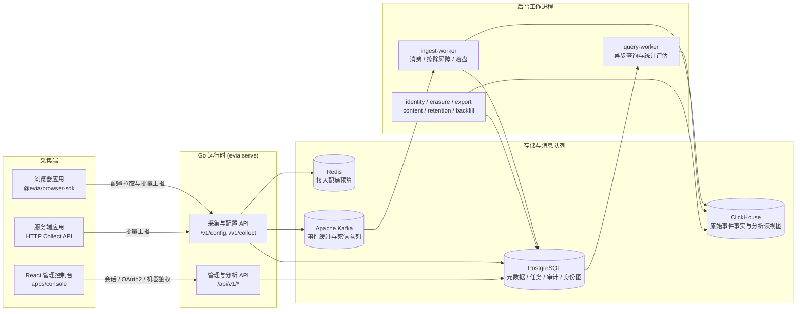
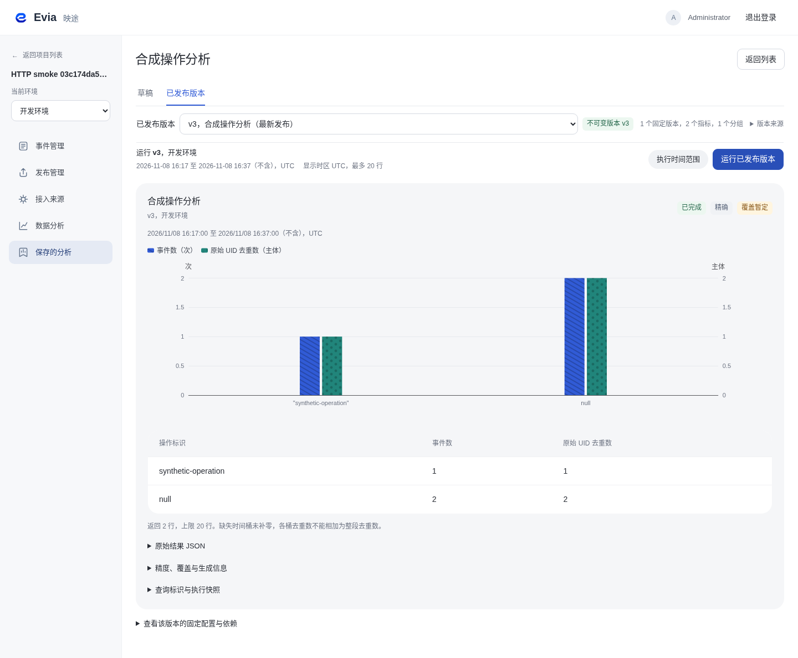

# Evia 映途

自托管事件采集、用户行为分析与在线实验平台。以强契约事件目录为核心，串联前端/服务端采集、实时数据管道、多维行为分析、指标复用、版本化看板与 A/B 实验闭环。

[](backend/go.mod)
[](package.json)
[](deploy/)
[](deploy/)
[](deploy/)
[](deploy/)

---

## 核心能力

### 契约驱动的事件治理与发布
- **事件目录与版本发布**：支持事件与字段 Schema 定义、样例验证、差异对比与不可变版本发布（Release），避免业务代码与分析口径漂移。
- **交付就绪验证与激活**：发布定义经 Kafka -> ClickHouse 端到端探针回读形成就绪租约（`ingestion_ready`），再通过显式版本比较与幂等键激活生效。
- **内置平台系统事件**：支持保留事件 `sys.page_view`、`sys.identity_link`、`sys.session_end`、`sys.page_scroll`、`sys.operation_failed`、`sys.heatmap_click` 与 `sys.content_chunk`，走统一契约与预算门控。

### 高可靠采集与第一方浏览器 SDK
- **受控接入与限流**：支持浏览器（Origin 白名单）与服务端（Bearer 密钥）双类来源，支持凭据轮换/撤销与 Redis 分布式令牌桶配额（`EVIA_COLLECTION_RATE` / `EVIA_COLLECTION_BURST`）。
- **签名配置下发**：`GET /v1/config` 支持强/弱 ETag `304` 协商缓存与 Ed25519 配置签名校验，防止公开配置在传输链路中被篡改。
- **零依赖浏览器 SDK（`@evia/browser-sdk`）**：纯 ESM + TypeScript 实现，提供 SPA 页面与导航上下文、有界队列、可选持久化队列（`persistQueue`）、同标签页跨文档会话连续性（`persistSession`）、指数退避重试与逐项回执。

### 多维用户行为分析与 A/B 实验
- **多模型分析引擎**：支持事件计数、UV、趋势分桶（分钟/小时/天/周）、原始身份行为链、有序漏斗、自然日/周/月留存队列、主体分群、聚合路径、多模型归因（末次/首次/线性/U 型/时间衰减）与坐标热力图。
- **端到端 A/B 实验**：覆盖实验配置与生命周期管理、签名 `/v1/config` 下发、SDK 确定性本地分流（FNV-1a）与自动曝光上报，以及内置统计评估（SRM 卡方检验、转化率双比例 Z 检验、数值均值 Welch t 检验与 95% 置信区间）。
- **版本化身份图**：`identity-worker` 周期折叠跨设备身份关系并生成不可变身份修订，查询支持 `resolved_person` 主体展开，并与数据擦除屏障联动防复活。
- **加密会话回放**：支持浏览器端混合加密 DOM 快照与增量 Mutation 分段上报，受权读取后在无网沙箱中重建回放。

### 资产复用、数据生命周期与治理
- **复用型分析资产**：支持不可变版本化的**独立指标**（含复合公式指标 DAG 展开）、**保存分析**（归档/搜索/一键导出）、**版本化看板**（1–12 个组件、统一时间范围、逐图筛选、原子入队）与**定时报告**。
- **数据生命周期与合规**：内置 CSV/Parquet 异步导出、保留策略与归档、合规主体擦除（Erasure）、历史数据回填（Backfill）与诊断监控。
- **权限治理与 Agent 集成**：支持多项目/多环境隔离、成员角色与邀请、OAuth2 登录、审计日志、独立机器访问凭据（Machine Access），以及面向业务仓库的公开接入 Skills（`integrations/`）。

---

## 系统架构



> 管理 API 与采集 API 运行在同一 Go 二进制的职责边界内，可按业务负载水平扩展；各后台 Worker 按子命令独立拉起。完整逻辑链路与设计边界见 [架构说明](docs/architecture.md) 与 [功能覆盖清单](docs/feature-coverage.md)。有状态流计算（Flink）作为独立项目规划，当前未纳入主运行时。

<details>
<summary>查看架构图与控制台界面预览</summary>

- **平台逻辑架构图**：`docs/assets/event-data-architecture.png`
- **版本化看板（桌面端）**：
- **机器访问管理（桌面端）**：
- **保存分析工作区（桌面端）**：

更多移动端截图与图表维护说明见 [docs/assets/README.md](docs/assets/README.md)。

</details>

---

## 快速开始

### 环境要求

| 组件 | 推荐版本 | 说明 |
| --- | --- | --- |
| Go | `1.27.3` | 编译服务端二进制及运行 `-race` 测试（需 CGO / C 编译器） |
| Node.js / pnpm | `24.22.1` / `11.25.0` | 构建控制台、SDK、API Client 与浏览器测试 |
| Python | `3.12+` | 契约校验、代码生成及运维工具测试 |
| Docker Compose | `v2` | 拉起本地 PostgreSQL 17.9 / Kafka 4.4 / ClickHouse 26 / Redis 8.10 |

### 1. 生成本地配置并启动依赖

`.env.example` 仅作配置项说明，请按 [本地开发说明](docs/runbooks/development.md) 生成本地私有 `.env`（`0600` 权限），随后启动依赖并初始化数据库与管理员账号：

```bash
# 加载本地配置
set -a && source .env && set +a

# 启动本地 PostgreSQL（完整链路测试可按 docs/runbooks/dependencies.md 启动 Kafka/ClickHouse/Redis）
docker compose --env-file .env -f deploy/compose.dev.yaml up -d --wait postgres

# 编译 Go 二进制，执行数据库迁移（当前最新 054_experiments.sql）并初始化管理员账号
mkdir -p bin
go -C backend build -o "$PWD/bin/evia" ./cmd/evia
./bin/evia migrate
./bin/evia bootstrap
```

### 2. 启动服务端与控制台

```bash
# 终端 1：启动 HTTP API（管理 + 采集）
./bin/evia serve

# 终端 2（启用完整采集与分析链路时）：启动消费与查询工作进程
./bin/evia ingest-worker
./bin/evia query-worker

# 终端 3：安装前端依赖并启动 React 管理控制台
pnpm install --frozen-lockfile
pnpm dev
```

生产部署拓扑、高可用配置与运维手册见 [部署说明](docs/runbooks/deployment.md) 与 [高可用手册](docs/runbooks/ha.md)。

---

## 浏览器 SDK 示例

`@evia/browser-sdk` 当前提供工作区源码与本地构建产物（`pnpm build:sdk`），完整配置项与生命周期语义见 [浏览器 SDK 文档](docs/browser-sdk.md)：

```ts
import { createEviaClient } from '@evia/browser-sdk';

const evia = createEviaClient({
  endpoint: 'https://analytics.example.com',
  writeKey: 'evia_pub_replace_with_source_key',
  projectId: '00000000-0000-0000-0000-000000000000',
  environment: 'production',
  autoPageViews: true,
  autoIdentityLink: true,
  persistQueue: true,
  persistSession: true,
});

// 初始化客户端并拉取已发布的公开事件与实验配置
await evia.init();

// 绑定已登录用户身份
evia.identify('user_10042');

// 本地确定性 A/B 分流，并按配置自动上报去重曝光事件
const assignment = evia.evaluateExperiment('home_feed_ranking', {
  fallback: 'control',
});

// 上报已在事件目录发布并激活的业务事件
evia.emit('article_opened', {
  article_id: 'a_9081',
  variant: assignment.variant ?? 'control',
});
```

---

## 命令行与运行时角色

单一 Go 二进制 `bin/evia` 通过子命令承担不同运行时与运维职责：

| 子命令 | 职责 |
| --- | --- |
| `serve` | 托管管理 API、公开配置 `/v1/config` 与事件采集 `/v1/collect` |
| `ingest-worker` | 消费 Kafka 事件流，执行擦除屏障检查并写入 ClickHouse，同时维护发布就绪探针 |
| `query-worker` | 消费 PostgreSQL 分析任务队列，执行 ClickHouse 多维查询、公式指标与实验统计评估 |
| `identity-worker` | 周期折叠身份关联事件，生成不可变身份图修订快照 |
| `erasure-worker` | 执行合规主体擦除作业并写入防复活墓碑 |
| `export-worker` | 异步生成 CSV / Parquet 查询与保存分析导出文件 |
| `content-worker` | 处理会话回放加密内容分段并落盘保护对象 |
| `retention-worker` | 执行数据保留窗口清理与归档策略 |
| `backfill-worker` | 执行历史事件受控回填作业 |
| `property-slots` | 管理 ClickHouse 热点属性专用列规划与回填 |
| `migrate` / `bootstrap` / `account-*` | 数据库显式迁移、初始管理员创建与运维账号治理 |

---

## 仓库布局

| 目录 | 职责 |
| --- | --- |
| `backend/` | 单一 Go 模块，清晰分离 HTTP 传输层、领域策略、分析引擎、数据管道与存储适配 |
| `contracts/` | OpenAPI 规范、JSON Schema 与系统事件契约样例（前后端代码生成的单一真相） |
| `apps/console/` | React 管理控制台业务页面（基于原生 HTML 与自建设计系统，按需加载 ECharts） |
| `packages/design-system/` | 共享主题令牌、布局原语与无障碍交互组件 |
| `packages/api-client/` | 基于 OpenAPI 自动生成的接口类型与统一请求封装 |
| `packages/browser-sdk/` | 零运行时依赖的浏览器事件与实验 SDK 及单元测试 |
| `integrations/` | 公开业务接入 Skills 与白名单打包工具（供外部业务仓库与 Agent 使用） |
| `deploy/` | 本地 Docker Compose 依赖、ClickHouse 表结构与高可用参考配置 |
| `tooling/` | 代码生成、契约/命名/边界检查、压测、备份与监控校验脚本 |
| `docs/` | 架构说明、模块设计文档、运维 Runbook、工程规范与验证记录 |

---

## 验证与质量门禁

所有契约变更均需通过代码生成一致性检查；集成测试与端到端测试依赖真实基础设施，缺失依赖时会显式失败：

```bash
# 契约与生成代码一致性检查
make generated-check

# 静态检查、命名与依赖边界门禁、Go 竞态单测、前端类型/构建与 SDK 测试
make check

# 真实依赖集成测试（需配置对应的 EVIA_TEST_* 环境变量）
make integration-test   # PostgreSQL 存储层
make pipeline-test      # Kafka -> ClickHouse 写入管道
make budget-test        # Redis 分布式接入预算
make query-test         # ClickHouse 分析查询引擎
make browser-test       # Playwright 浏览器全栈验证
```

---

## 文档导航

### 产品与模块文档
- [架构说明](docs/architecture.md) | [功能覆盖清单](docs/feature-coverage.md) | [生产就绪清单](docs/production-readiness.md)
- [浏览器 SDK](docs/browser-sdk.md) | [发布与交付机制](docs/releases.md) | [事件采集管道](docs/pipeline.md) | [接入配额与预算](docs/budget.md)
- [行为分析引擎](docs/analysis.md) | [版本化指标](docs/metrics.md) | [保存分析](docs/saved-analyses.md) | [版本化看板](docs/dashboards.md) | [定时报告](docs/reports.md)
- [身份图与解析](docs/identity.md) | [机器访问控制](docs/machine-access.md) | [项目治理](docs/project-governance.md) | [公开接入 Skills](integrations/README.md)

### 运维与测试手册
- [本地开发](docs/runbooks/development.md) | [依赖准备](docs/runbooks/dependencies.md) | [生产部署](docs/runbooks/deployment.md) | [高可用](docs/runbooks/ha.md)
- [账号管理](docs/runbooks/accounts.md) | [备份恢复](docs/runbooks/backup-restore.md) | [可观测性](docs/runbooks/observability.md) | [SLO 指标](docs/runbooks/slo.md) | [性能压测](docs/runbooks/benchmark.md)

### 工程规范与演进记录
- [接口规范](docs/standards/api.md) | [开发与提交规范](docs/standards/development.md) | [界面规范](docs/standards/ui.md)
- [开发进度与验证证据](PROGRESS.md) | [开发交接说明](HANDOFF.md)

---

## 工程原则与安全声明

- **契约先行**：所有接口与事件信封以 `contracts/` 为单一真相，通过 `make generate` 同步生成 Go 线缆类型与 TypeScript API Client。
- **严格隔离**：所有认证、缓存、配额与查询均绑定至已授权的项目与环境作用域，来源写凭据无法代替管理或机器访问凭据。
- **数据边界**：本仓库仅包含源码、契约与合成测试样例，不包含任何真实业务数据或可用生产凭据。
