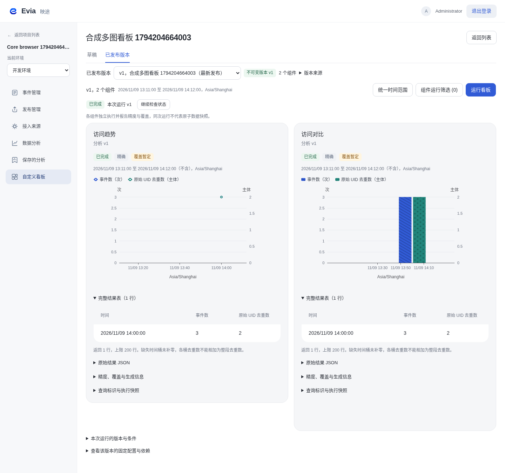
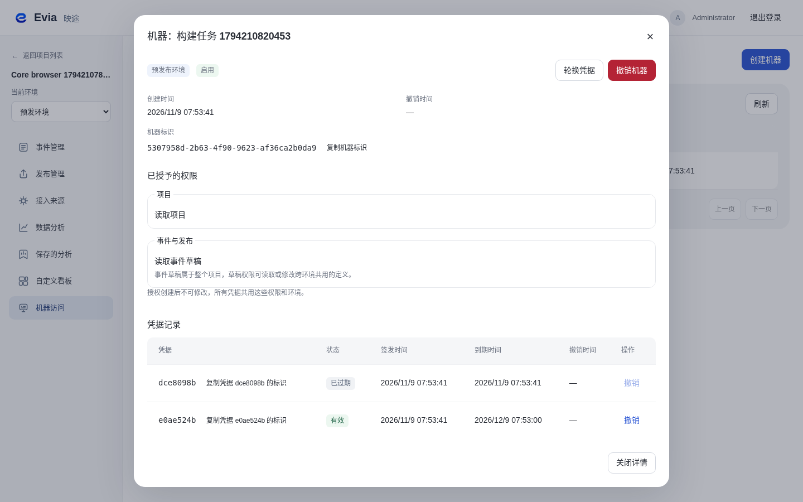

# Evia 映途

私有化事件采集与用户行为分析平台。以业务事件定义、稳定用户身份和可解释的分析口径，把页面访问、阅读和互动连接起来。

接力开发请先读 [开发交接文档](HANDOFF.md)，其中包含当前功能基线、工程约束、验证证据、环境复用方式及待办验收条件。

当前功能包括项目与会话、事件/字段定义、不可变发布与激活、接入来源、Kafka 到 ClickHouse 写入，以及计数、UV、趋势、原始身份行为链和有序漏斗。保存分析支持编辑、校验、版本发布和运行。

当前可用的扩展模块：

- [浏览器 SDK](docs/browser-sdk.md)：零运行时依赖，读取已发布事件配置，显式上报自定义事件，保留用户/页面/导航上下文，支持有界队列与不可变重试。当前提供工作区源码和本地打包，尚未发布 npm。
- [版本化看板](docs/dashboards.md)：服务端支持 1–12 个分析组件、布局、固定版本、统一时间范围、逐图筛选、原子入队与取消；控制台支持键盘布局、版本切换、冲突恢复和真实多图结果。

[机器访问](docs/machine-access.md)已支持独立主体、项目/环境权限、一次性凭据、轮换与撤销，查询工作进程检查原始凭据。[公开接入 skills](integrations/README.md)提供事件梳理、发布和 SDK 验证流程，与内部维护规范分开打包。[项目治理服务端](docs/project-governance.md)已支持成员角色、项目设置和审计查询，并提供运维账号创建命令；对应控制台待交付。[独立指标服务端](docs/metrics.md)支持统计口径注册、差异校验、不可变发布与整段/趋势运行。跨身份合并、指标公式与看板引用、导出和数据生命周期仍未交付。[功能覆盖清单](docs/feature-coverage.md)逐项列出已实现、部分实现和缺口，[PROGRESS.md](PROGRESS.md)保存实际验证记录。正式 OpenAPI 中的早期未实现占位操作已移至待办。

百万事件上报和存储核对已有真实压测证据。指定 UID 筛选、行为链和有序漏斗 **273 / 273 通过**，默认双工作任务的完整矩阵仍只有 **514 / 728 成功**；属性读取和共享内存预算仍有失败，详见[百万查询报告](docs/verification/query-capacity-2026-11-09.md)。当前结果不构成千万用户容量或生产就绪声明。

<details>
<summary>查看自定义看板</summary>



使用合成事件，经真实 API 与查询工作进程生成结果。[移动端截图](docs/assets/dashboard-mobile.png) 展示相同版本和数据，图表随卡片缩放，宽表格在自身区域横向滚动。

</details>

<details>
<summary>查看机器访问管理</summary>



Owner 可创建独立机器身份、轮换和撤销凭据。[移动端截图](docs/assets/machine-access-mobile.png)与[验证记录](docs/verification/machine-access-2026-11-09.md)包含会话隔离、一次性密钥恢复和真实接入链的检查。

</details>

历次真实依赖、公开 HTTP 和浏览器验证保存在[开发进度](PROGRESS.md)及其关联记录中。当前结果不构成千万用户容量或生产就绪声明。

<details>
<summary>查看本轮压测观测</summary>


图表由[实际报告数据](docs/verification/data/capacity-2026-11-09.json)绘制。完整矩阵 **514 / 728 成功**，延迟只统计成功样本，不能据此忽略失败或宣称千万用户容量。[上一轮报告](docs/verification/load-and-maintainability-2026-11-08.md)保留上报吞吐、早期失败及恢复证据。

</details>

## 架构概览


图 1，平台逻辑链路。实线框表示已实现模块，虚线框表示规划模块；管理与采集 API 是同一 Go 运行时的职责划分，连接表示数据和配置依赖，不代表独立部署实例。容量目标及验证边界见 [架构说明](docs/architecture.md) 和 [开发进度](PROGRESS.md)。

## 启动与验证

使用 Go 1.27.3、Node 24.22.1、pnpm 11.25.0 和 PostgreSQL 17.9。按 [本地开发说明](docs/runbooks/development.md) 生成本地配置，显式执行数据库迁移及初始账号创建，再启动 API 和控制台。

本轮升级需用新二进制显式迁移至 `012`，再启动 API 与工作进程；治理与账号准备见[项目治理说明](docs/project-governance.md)，机器凭据边界见[机器访问说明](docs/machine-access.md)。

服务端链路测试另外使用 Kafka 4.4.0、ClickHouse 26.8.36.3 和 Redis 8.10.3，安装与私有配置见 [依赖说明](docs/runbooks/dependencies.md)。

```sh
make generated-check
make check
make integration-test
make pipeline-test
make budget-test
make query-test
make browser-test
```

集成测试和浏览器测试需要说明中配置的真实依赖及专用测试账号。完整服务端 HTTP 验收还需显式迁移及启动 API、接收工作进程和查询工作进程，按 [服务端验收说明](docs/runbooks/backend-smoke.md) 执行。缺少依赖时测试失败。部署边界见 [运维说明](docs/runbooks/deployment.md)。

## 技术方向

Go 服务端、React 管理控制台；PostgreSQL 管理元数据，Kafka 缓冲事件，ClickHouse 支撑分析，Redis 提供分布式接入配额。有状态的身份图与 Flink 处理单独规划。TypeScript 浏览器 SDK 支持业务方在自己的仓库维护网站事件调用；业务 Agent 可使用公开接入 skills 与受限机器管理凭据。

发布定义保存后先等待交付验证：带项目、环境和版本范围的探针经过真实 Kafka 写入及 ClickHouse 回读，形成有期限的就绪租约；随后通过显式版本比较和幂等键激活。`ingestion_ready` 按有效租约派生，租约过期会失去就绪资格。公开配置先验证来源与发布资格，再处理 ETag。千万用户仍是架构目标，尚未进行对应硬件、流量分布和故障条件下的容量验证。

已发布事件版本由保存分析固定引用，看板再固定保存分析版本。校验不执行查询，发布不修改历史版本；运行显式绑定时间范围、时区和逐图筛选，使用现有共享任务预算。看板的一次入队是原子的，各图结果不是跨查询的原子数据快照。完整语义见[看板说明](docs/dashboards.md)。图 1 由 ImageGen 生成并按实现校对，[维护说明](docs/assets/README.md)记录语义来源。

## 仓库布局

| 目录                      | 职责                                                  |
| ------------------------- | ----------------------------------------------------- |
| `backend/`                | 单一 Go 模块，应用策略、HTTP 边界、持久化适配分别组织 |
| `contracts/`              | OpenAPI、JSON Schema 与合成数据契约样例               |
| `apps/console/`           | 控制台业务页面                                        |
| `packages/design-system/` | 共享主题、布局和交互组件                              |
| `packages/api-client/`    | 生成的接口类型及统一请求处理                          |
| `packages/browser-sdk/`   | 独立浏览器事件 SDK、类型及有界资源测试                |
| `.agents/skills/`         | 平台内部开发规范                                      |
| `integrations/`           | 公开业务接入 skills、有界请求与清单工具、白名单打包    |
| `deploy/`、`tooling/`     | 本地依赖、迁移、生成与验证工具                        |

控制台采用 Evia 自建 React/原生 HTML 组件，Ant Design 及其依赖已移除。共享组件覆盖键盘和鼠标状态、表单校验、焦点恢复、弹窗、通知、Tab 与未保存内容保护。专业趋势和漏斗图按需加载 ECharts，并提供对应结果表；普通页面不会加载图表渲染模块。此前基础组件迁移的体积比较见 [前端验证记录](docs/verification/native-ui-2026-11-07.md)，不能将该比例当作新增业务功能后的总体体积结论。

管理 API 支持控制台会话及显式开放接口的机器 Bearer 认证，机器凭据管理限当前项目 owner。来源写凭据只能上报事件，不能代替机器管理凭据。`sys.*` 仍只有契约样例，页面计数使用业务方显式发布的自定义页面事件；SDK 的导航上下文目前覆盖单个客户端实例内的 SPA，跨文档会话连续性与匿名历史合并另列待办。

## 工程规范

- [接口规范](docs/standards/api.md)
- [测试与提交规范](docs/standards/development.md)
- [界面规范](docs/standards/ui.md)
- [架构与范围](docs/architecture.md)

使用者执行代码前应阅读对应阶段的启动说明。仓库不包含真实业务数据或可用的生产凭据。
