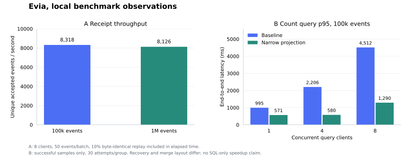

# 大规模上报、查询与工程整理

执行日期：2026-11-08，UTC。本轮完成可复现压测工具、实际十万/百万事件验证、压测发现的接收边界修复、趋势查询列裁剪，以及保存分析前端的职责拆分。百万条上报和存储核对完成，**百万条全量查询仍超过默认资源预算**，不代表千万用户容量或生产就绪。

## 环境与口径

- 主机可用 CPU 数为 5，内存约 17.6 GiB，文件系统总量约 31.5 GiB；同机仍有原功能验证环境，未同时运行构建或浏览器测试来测量压测阶段。
- PostgreSQL 17.9、Kafka 4.4.0、ClickHouse 26.8.36.3、Redis 8.10.3，独立 `evia-benchmark` 项目、端口、数据库、主题和磁盘卷。单 Kafka 分区/副本，单接收工作进程，两个查询工作任务；Go 进程 `GOMAXPROCS=2`。
- Docker 报告 `MemoryLimit=false`、`CPUCfsQuota=false`、`CgroupDriver=none`。Compose CPU/RAM 是请求值，未被独立 cgroup 强制；Docker 容器统计共享范围，不能解释为每个容器的真实资源消耗。
- ClickHouse 服务端内存上限 3 GiB；每查询保留 2,000,000 行、256 MiB 扫描、512 MiB 内存、30 秒执行上限。启动时原开发配置 1.5 GiB 上限曾使健康检查失败，独立压测配置调整后才执行本轮数据测试。
- 上报使用真实 `/v1/collect`，每批 50 条、并发 8，不自动重试。唯一数据后按原字节重放前 10%，一百万条对应 100,000 个原始 UID。事件时间分布覆盖准备时刻之前 30 分钟，属性与 UID 按固定模运算相关，不代表真实长尾数据。
- 查询通过真实异步 API 提交、轮询和取结果，每类在并发 1、4、8 下各运行 30 个重复样本，另保留一次首次观测。端到端延迟包括排队和轮询，分位数仅针对成功样本。30 个样本的 p99 接近最大值，不构成稳定生产尾延迟估计。

复现步骤见 [压测手册](../runbooks/benchmark.md)。默认限流先单独测试；容量轮次显式设置每秒 20,000 条、突发 40,000 条，没有关闭限流或提高查询预算。

## 接收与落库

| 轮次 | 唯一事件接受数 | 原样重放接受数 | 用时 | 唯一事件/秒 | 请求 p95 / p99 |
| --- | ---: | ---: | ---: | ---: | ---: |
| 十万，修复后 | 100,000 | 10,000 | 12.023 秒 | 8,317.7 | 72.29 / 97.30 ms |
| 百万 | 1,000,000 | 100,000 | 123.059 秒 | 8,126.2 | 76.72 / 103.25 ms |

唯一事件/秒的分母包含重放阶段。延迟来自 2,200 / 22,000 次真实 HTTP 请求，对数直方图上界误差约 2%。两轮所有逐项回执均接受，没有限流、服务器错误或隐藏重试。

默认每秒 1,000 条、突发 2,000 条的独立验证中，短时间尝试 10,000 条，接受 2,550 条，7,450 条明确限流，200 个请求中 51 个 HTTP 202、149 个 HTTP 429。这个突发样本验证拒绝语义，不能用其瞬时平均值评价稳态限流速率。

首次十万条曾接受 99,999 条，另 1 条返回可重试 `SCHEMA_NOT_READY`。两秒计划缓存期限恰好在单项属性校验中到达，被误当作发布资格失效。修复后候选项统一在批次入队前刷新、检查资格，同一修订使用同一检查时间。回归在旧实现上复现 HTTP 202 内部分拒绝，在新实现上通过；真正未就绪、元数据故障或不可变定义变化仍禁止入队。

百万轮次在 `17:38:50.603` 开始，`17:40:53.662` 完成全部接收。ClickHouse 插入日志记录 8,653 次插入、1,100,000 行，最后一次写入在 `17:43:23.755` 完成，即接收结束后约 **150.1 秒**。`17:44:58.520` 读取 Kafka 消费位置为 `1,322,549 / 1,322,549`，积压为 0；这一总位置还包含此前独立测试项目。在 `17:41:59` 的采样中曾看到 411,998 条积压，此值不是证明过的峰值。

该百万项目的只读存储审计得到 1,100,000 原始行、1,000,000 个来源/事件标识组合、100,000 UID。此数据集只含原样重放，审计支持其去重期望，**不等于百万条公开查询接口已通过**。

## 查询优化与限制

原事实视图每次以完整事件元组选取去重胜出行，单纯计数也会读取上下文、属性和 SDK 等无关列。趋势查询现在仅选择实际需要的胜出列，保留一个元组 `argMin`、完全相同的来源/事件身份和精确时间/哈希顺序。项目、环境可提前限制；事件、时间、UID 和属性过滤仍在选定胜出行之后。行为链和漏斗路径继续使用原事实视图。

真实 ClickHouse 的 18 类对照验证涵盖冲突重放、不同来源/项目/环境、胜出 UID 为 null、时间精度、缺失/null/false/0、数组、分组、指标和水位。查询工作进程现在直接读取原始表的必要列，部署者需核对它对指定数据库 `event_facts_raw` 的只读权限；业务调用者仍只使用受权 API，不能提交任意 SQL。

十万条原实现的 728 次样本中，697 次成功，31 次因内存资源限制失败，都是 `QUERY_COST_EXCEEDED`。百万轮次原实现的首次查询也因内存限制失败，未进入完整查询矩阵。

优化后百万条全量查询读至约 931,215 行、268,564,532 字节时达到扫描上限；这是明确保留的默认预算限制。此次还发现 ClickHouse 的 `TOO_MANY_BYTES` / `TOO_MANY_ROWS` 被归为通用错误，已补充映射及回归，统一返回不可重试的 `QUERY_COST_EXCEEDED`。没有通过增大预算来把本轮标成成功。

最终十万条复测 **728 / 728 成功**，加上可见性核对和取消检查共提交 731 个任务。成功样本的端到端 p95 如下：

| 查询 | 并发 | 原实现 p95 | 最终 p95 |
| --- | ---: | ---: | ---: |
| 计数 | 1 | 995.15 ms | 570.78 ms |
| 计数 | 4 | 2,205.77 ms | 580.33 ms |
| 计数 | 8 | 4,512.16 ms | 1,290.38 ms |
| 精确 UID | 8 | 12,156.40 ms | 1,694.92 ms |
| 行为链 | 8 | 4,306.07 ms | 6,325.22 ms |
| 有序漏斗 | 8 | 3,965.60 ms | 6,723.92 ms |

计数查询日志中，原实现平均读取 116,518 行、99,921,046 字节，单查询峰值内存 295,946,960 字节；最终平均读取 112,047 行、26,107,063 字节，峰值内存 104,741,108 字节。行为链和漏斗未做此次列裁剪，其高并发延迟没有改善。

前后数据的语义一致，但后台合并布局有变化，恢复期间也重启过压测 ClickHouse，因此不能把端到端差值全部归因于 SQL 调整；读取列、语义对照和资源边界是独立证据。完整样本、失败记录、查询日志摘要和二进制哈希见[机器可读证据](data/load-2026-11-08.json)。

## 存储与资源边界

百万轮次及此前测试共形成约 510 MB 有效分片，检查时另有 10,415 个旧分片、约 3.62 GB 暂存数据。小批次同步写入产生的合并和旧分片保留造成明显磁盘放大，不能按最终压缩体积配置空间。

剩余空间跌破阈值后暂停接收工作进程，没有删除业务事实或队列。核对时百万数据已全部写入、消费位置已提交。仅清除可重建的 Go 编译缓存释放应急空间，旧分片随后由 ClickHouse 自然回收；压测 ClickHouse 因内存压力做过恢复重启。后续独立压测配置增加 **2 GiB 磁盘保留**，已实际查询 `system.disks.keep_free_space` 验证；百万测试手册要求开始前至少 8 GiB 余量。这个保留设置是在初始测量之后加入的，不能作为原轮次已有保护来描述。

百万上报至最终插入的五秒采样共 55 次，Go API / 接收工作进程 / 查询工作进程 RSS 峰值约 56.4 / 66.5 / 22.7 MiB。这是这些指定进程的观测值，不含数据库子进程，也不是跨平台容量保证。Docker 共享 cgroup 的 CPU/RAM 数据已标记为不可按容器归属；查询日志另保留执行读取量和单查询内存。

## 工程整理与验证

保存分析页面从 957 行拆为 174 行组合入口，编辑器从 1,139 行拆为 201 行入口，运行器从 915 行拆为 154 行入口。请求授权与取消、草稿恢复、发布重试、局部编辑、焦点以及结果解释分开维护。分拆依据职责，不设置任意文件行数门槛，不以一个巨型状态对象替代原页面。

`make check` 已包含 TypeScript 实际模块解析的依赖方向/运行时循环检查和压测工具测试。15 个边界夹具通过，真实源码树 73 个模块、173 条运行时依赖，无循环、无豁免。类型依赖仍接受包方向检查；非字面量动态模块加载是明确的静态分析限制。规范见 [模块职责](../standards/frontend-modules.md)。

- Go 全量 vet、竞态测试通过；趋势分析真实 ClickHouse 集成竞态测试 11.090 秒通过。
- Python 压测策略 11 项、客户端 12 项、类型、格式、生产构建和契约/命名检查通过。
- 真实后端完整浏览器回归 **38 项通过，55.8 秒，零重试**；另核对桌面/移动端合成图表，无页面错误或文档横向溢出。
- 最终查询服务二进制替换后，真实控制台完整链与来源生命周期专项再次 **2 / 2 通过，29.6 秒**，没有重试或模拟成功响应。
- 已发布入口为 `index-BL8cFrcM.js`，保存分析分块 `saved-analyses-CrhgA7Mn.js`。入口 gzip 116.72 kB，保存分析分块 gzip 24.49 kB，图表仍独立延迟加载。拆分增加了该业务分块体积，不能称为打包性能优化。

剩余工程债务包括较大的即席分析和来源管理页面。多图看板、浏览器 SDK、公开接入 skills 等原有范围继续保留；本轮没有把设计稿或空入口算作已实现。

首次主分支 CI 暴露既有重试测试依赖 5 ms 真实时钟：调度暂停可以让合法的截止路径只执行一次尝试。已改用 Go 虚拟时间，保留多次尝试、零提交、单次拉取和严格释放/关闭顺序的断言；竞态模式连续 100 次通过。没有修改生产重试行为，也没有只重跑 CI 来掩盖不稳定用例。

## 后续容量工作

默认预算下的百万级全量查询尚不支持。需要继续设计选定去重事实后的时间/身份索引或预计算，降低对项目历史的全量读取，再结合显式部署预算、跨租户隔离和持续混合读写验证。不能把 UID 条件提前到冲突重放的胜出选择前，也不能用简单增大预算替代存储结构设计。

接收端已获得单机合成上报证据，物化端还需批大小、提交频率、合并压力与积压恢复的参数扫描。长保留期、高基数、复杂全站漏斗、故障注入、多副本耐久性及千万用户并发仍是开放验证项。
