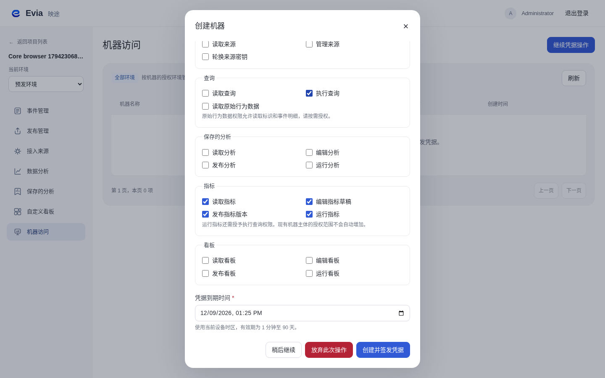

# 指标服务端验证，2026-11-09

本轮新增独立原子指标的 10 个接口，完成契约、领域策略、PostgreSQL、HTTP、运行时和公开接入工具。实现说明见[版本化指标](../metrics.md)。指标公式、分析/看板直接引用指标版本和指标专用控制台仍未交付。

## 测试对象

- 后端功能源码提交：`ac81e3e`，backend tree `77574a229183d67d7bae05414fa724176b2ae144`。
- 本地二进制由该批功能工作树构建，构建时尚未提交；SHA-256 为 `be7fdcb37054f7af7f20633f53ebf84ed4b7f1fdc19971e8f47f3927feaede76`。
- 独立功能库从 `011` 显式迁移至 `012`。API、接收工作进程、查询工作进程均使用新二进制，健康检查返回 204。
- 实际依赖为 PostgreSQL、Kafka、ClickHouse、Redis，使用合成账号、项目、事件和凭据。PostgreSQL 集成测试另建独立 schema，不复用功能项目。
- 百万数据压测运行库未改动，本轮不是容量测试。

## 分层证据

| 分类 | 实际检查与结果 |
| --- | --- |
| 契约 | OpenAPI/JSON Schema 验证通过，新增 12 类指标用例、57 个不兼容单位反例及未知字段、事实版本、运行参数边界；生成 136 个 wire 类型与离线验证包 |
| 领域 | 规范化复制、固定事件选择、主体/单位、精度、筛选 AND、整段 UV、依赖/范围/基线摘要及语义 diff 的竞态测试通过 |
| 完整后端 | `make backend-test` 通过，包含 gofmt、全量 vet 和 `go test -race ./...` |
| PostgreSQL | 完整 `-race -tags=integration` 通过，127.543 秒；本轮新增 16 个顶层集成测试及其子测试 |
| 实际 HTTP/查询 | 独立指标验收通过，139 次 HTTP 请求、4 个异步查询，使用真实上报及查询工作进程 |
| 接入工具 | 14 个公开资产测试通过；实际调用 `activity_api.py` 读取指定指标版本，响应写入临时私有文件 |
| 前端兼容 | 格式、TypeScript、16 个客户端测试及生产构建通过；45/45 浏览器回归通过，1.6 分钟，无跳过 |

数据库证据包括：并发创建/更新/发布，修订与幂等冲突，事务审计失败回滚，不可变版本/幂等记录保护，事件发布资格与数值字段类型，原始数据权限，32 个排队和 4 个运行任务的共享预算，查询过期/删除、来源引用外键及有界清理。`011 → 012` 升级保留既有事件、分析版本、任务和机器权限；扩充授权白名单不会给旧主体追加权限。

HTTP 与运行时测试覆盖全部 10 个路由的未登录、混合认证、精确机器授权和安全失败响应；还检查请求头歧义、JSON/查询参数、ETag、游标作用域、结果 Schema 及未配置查询存储。代码审查未留有未解决的发现；审查本身不替代上述执行证据。

## 真实链路结果

验收通过 API 注册并发布合成页面事件，创建服务端来源，等待真实交付就绪并激活，再发送事件。6 次事件提交全部接受，包含一次重复，查询核对为 5 条去重事实、3 个原始 UID。

| 查询 | 实测结果 |
| --- | --- |
| 固定属性条件后的按天计数 | 3 |
| 相同条件下整个时间范围的精确 UV | 2 |
| 固定条件与冲突运行条件组合 | 0，运行条件不能扩大指标范围 |

另验证两个不可变计数版本、创建/发布/查询重试、草稿 CAS、列表与版本读取、全部 10 条机器指标路由成功、原分析权限的 10 次拒绝和错误环境的 10 次拒绝。轮换后撤销确切旧凭据，4 次旧凭据读取/运行被拒绝，新凭据仍可读取。审计记录对应的独立机器主体与原始凭据，没有打印密钥或完整响应。

首次运行在不兼容单位反例处停止：测试原先期待领域错误 `INVALID_METRIC_UNIT`，而权威 Schema 已在更早的 HTTP 边界返回 `VALIDATION_FAILED`。修正验收断言后完整通过；这是测试预期修正，不是放宽服务端校验。失败与成功运行均清理自己的活动任务/来源/机器凭据/会话，合成配置与审计保留。

## 浏览器证据

本轮只扩展现有机器授权选项，未新增指标管理页面。生产构建入口 `/assets/index-CFt0DjHa.js`，浏览器核对实际服务的同一资源。完整真实控制台流程验证键盘切换四项指标权限，创建后通过 API 精确核对七项授权（四项指标权限、执行查询、读取项目和读取事件草稿），同时保留未知结果重试、凭据轮换、撤销及会话检查。



截图只展示授权表单，已人工检查无密钥，模态框纵向滚动、底部操作可见，没有可见的横向溢出。自动密钥流程的 trace、video 和失败截图保持关闭。

## 重现

先依[后端验收说明](../runbooks/backend-smoke.md)准备专用依赖及私有运行配置，显式迁移、启动三个工作进程，再执行：

```sh
make contracts-check
make generated-check
make backend-test
make integration-test
python3 -m unittest discover -s integrations/tests -v
python3 tooling/verification/browser_runtime.py run /path/to/private-runtime.env -- \
  python3 tooling/verification/metrics_smoke.py --binary /path/to/evia
```

完整 PostgreSQL 测试要求 `EVIA_TEST_DATABASE_URL`，不能把跳过依赖视为通过。功能验收只允许显式 loopback HTTP，使用本地 `account-create` 创建合成账号，不复用业务账号或数据。脚本有总时限和请求上限，凭据只进入私有环境及内存。

CI 已加入 `Verify independent metrics through real ingestion and query workers`，位于治理验收之后、浏览器回归之前；远端执行状态以对应 GitHub Actions 记录为准。

当前仍存在百万查询矩阵 `514/728` 的失败基线；原子指标复用同一引擎，没有消除属性读取和资源拒绝问题。未验证千万用户、长历史、生产多副本、备份恢复或持续混合压测。
