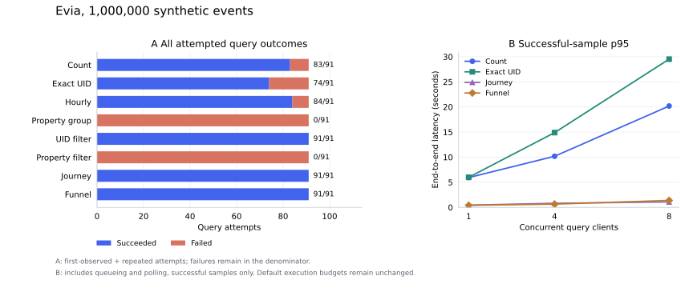

# 百万事件查询的存储改进与复测

执行日期：2026-11-09，UTC。本轮以已落库的百万事件为基准，交付紧凑胜出排序列、精确身份候选索引、固定授权范围的聚合简化，以及数值属性的正确性修复。每查询仍限制 2,000,000 行、256 MiB 扫描、512 MiB 内存和 30 秒执行时间。

## 实现与升级

迁移 `004` 将固定格式的完整哈希解码为 32 字节，并物化原有精确时间与历史时间的回退表达式。胜出顺序仍是接收时间、完整哈希、发生时间和事件时间，载荷仍通过一个元组 `argMin` 选择。它没有截短哈希、另建权威事实表或增加独立提交。历史非法哈希会使迁移失败，不能通过改写原值绕过检查。

迁移 `005` 为原始 UID 和匿名标识增加两个普通投影。查询只能从必要的身份等值条件寻找候选来源/事件组合，随后读取这些组合的所有版本，再选择胜出行。完整的身份、版本、时间和属性条件仍作用于胜出行；匹配的失败重放不能替代真实胜出行。投影缺失、未物化或禁用时，结果语义不变，但可能重新超过查询预算。

趋势聚合现在只将来源/事件标识作为分组键。项目与环境已在原始输入中固定为受权范围，因此在输出中恢复为绑定常量，减少每组重复字符串。原始表和候选子查询中的授权列都有明确表别名，避免外层常量别名覆盖真正的范围过滤。

先显式升级 ClickHouse，再更新查询工作进程；应用启动不会自动执行这些迁移。历史分区的列与投影物化必须独立安排、逐项等待完成并核对磁盘余量，DDL 成功不等于历史数据已经获得读取收益。操作、读权限和回退见 [紧凑列升级](../runbooks/compact-winner-upgrade.md)、[身份投影升级](../runbooks/identity-query-upgrade.md) 及 [部署说明](../runbooks/deployment.md)。

## 属性查询的正确性边界

真实数据库测试发现，`JSONType` 对浮点值返回 `Double`，原数字类型判断误用了 SQL 类型名 `Float64`。修复后，小数和指数形式进入已有数值计算，非数字类型继续排除。在旧代码上运行同一回归，预期求和 102 实际为 -3；修复后计数、求和、平均值、极值和分位数均与显式期望一致。

属性列裁剪原型没有交付。数据库的若干“原始 JSON”提取函数仍会改写 `1e2`、长小数和数组中的负零，不能证明其与原文档的查询结果一致。本轮没有增加属性迁移或偷偷切换读取路径。属性筛选与分组仍读取完整文档，其百万级成本问题保留为待办；候选方案及兼容性约束见 [属性读取设计](../plans/property-read-layout.md)。

## 测量条件

- 沿用 [上一轮](load-and-maintainability-2026-11-08.md) 的独立本地压测环境和百万数据：1,000,000 条唯一事件、100,000 条原样重放、100,000 个 UID。不是一百万并发用户。
- 主机可用 5 CPU、约 17.6 GiB 内存，仍有独立功能验证环境。Go 进程 `GOMAXPROCS=2`，两个查询工作任务，每查询最多两个 ClickHouse 执行线程。
- ClickHouse 26.8.36.3 的服务端总内存上限为 3 GiB。Docker 没有可用的独立 CPU/内存 cgroup 限制，不能将共享容器统计解释为各容器的实际消耗。
- 八类查询均经公开异步 API 提交、轮询、读取并核对具体结果，每类包含一次首次观测，以及并发 1、4、8 下各 30 个重复样本，共 728 次。另有可见性核对和取消检查，共 731 个任务。
- 分位数只涵盖成功样本，延迟包含排队和轮询。首次观测不是冷缓存；每档 30 个样本的 p99 不足以估计稳定生产尾延迟。漏斗限定为一个已知 UID 的两次有序访问，不代表全站复杂漏斗。
- 正式查询测量期间未同时运行构建、集成或浏览器测试。分片合并、缓存和服务端分配器状态没有完全固定，因此前后延迟差不能全部归因于某一个代码改动。

## 百万事件查询结果

完整基线运行于 `03:53:27.504–04:16:36.809Z`，最终后端运行于 `04:22:51.391–04:45:12.827Z`。**两轮均已包含紧凑列、身份投影和数值类型修复**，下表比较的是后续固定范围聚合与列别名限定调整，不能用来衡量全部存储优化的收益。两轮都使用两个查询工作任务及同一百万数据。所有失败均通过 API 明确返回 `QUERY_COST_EXCEEDED`，没有返回截短的成功结果。

| 查询 | 聚合调整前成功/尝试 | 聚合调整后成功/尝试 |
| --- | ---: | ---: |
| 事件计数 | 80 / 91 | 83 / 91 |
| 精确 UID | 79 / 91 | 74 / 91 |
| 小时分桶 | 80 / 91 | 84 / 91 |
| 属性分组 | 0 / 91 | 0 / 91 |
| 指定 UID 筛选 | 91 / 91 | 91 / 91 |
| 数值属性筛选 | 0 / 91 | 0 / 91 |
| 单 UID 行为链 | 91 / 91 | 91 / 91 |
| 单 UID 有序漏斗 | 91 / 91 | 91 / 91 |
| **合计** | **512 / 728** | **514 / 728** |

固定范围聚合简化未解决并发拒绝：最终计数、UID 和小时分桶仍有 32 次失败，属性两类另有 182 次失败。两轮总成功数只相差 2 次，不能据此宣称并发容量改善。指定 UID 的三个工作负载合计 273 / 273 通过。

最终成功样本的端到端 p95 如下。并发 4、8 的统计类样本存在失败，必须连同上表评估；不能把失败请求从容量结论中排除。

| 查询 | 并发 1 | 并发 4 | 并发 8 |
| --- | ---: | ---: | ---: |
| 事件计数 | 5.934 秒 | 10.178 秒 | 20.186 秒 |
| 精确 UID | 5.986 秒 | 14.888 秒 | 29.523 秒 |
| 小时分桶 | 4.608 秒 | 9.913 秒 | 20.656 秒 |
| 指定 UID 筛选 | 0.361 秒 | 0.411 秒 | 0.655 秒 |
| 单 UID 行为链 | 0.437 秒 | 0.815 秒 | 1.082 秒 |
| 单 UID 有序漏斗 | 0.412 秒 | 0.645 秒 | 1.382 秒 |

最初未升级的百万公开查询在可见性核对中无法完成精确 UID；迁移 004 后，计数/UID/小时分桶可完成冒烟查询，身份投影再使指定用户行为链和漏斗可完成。完整属性文档仍是独立成本。这些阶段的原始成功与失败记录均保存在[机器可读证据](data/capacity-2026-11-09.json)中。

最初未升级阶段复用了上一轮的最终二进制，SHA-256 有记录，但其构建元数据标记工作树有修改，基础修订为 `39cb558`，不能将它归属为本轮起点的干净源码构建。此后的紧凑列、身份投影、完整并发基线和最终后端均从各自冻结修订构建，`vcs.modified=false`；完整前后矩阵分别对应 `6375656` 和 `9dfa020`。

图由实际报告数据绘制，包含失败数量，不是生成的概念图。

### 并发拒绝与独立配置复验

最终窗口中，所捕获的数据库错误包含 41 次服务端总内存错误（241）和 165 次扫描字节上限错误（307）。内存错误明确来自服务端总上限；不能用单查询仍低于 512 MiB 解释为资源足够。查询日志按时间和项目筛选后不一定完整，也没有与每个 API 任务一一关联，不能直接用其执行记录数替换上表的 API 成功率。

随后保持后端二进制、数据库、3 GiB 服务端总内存及单查询预算不变，只将查询工作任务数改为 1，在 `04:46:40.212–04:48:46.500Z` 单独运行计数、精确 UID、小时分桶。每类一次首次观测、并发 8 下 8 个重复样本，共 **27 / 27 成功**，另含可见性和取消检查的总任务数为 30。并发样本 p95 分别为 **30.886、42.015、31.020 秒**，排队时间增加。

这是明确标注的小样本配置复验，不是新的完整矩阵，也不足以制定生产 SLO。它支持当前资源下限制工作并发的方向，同时显示了延迟代价；默认双任务配置的 214 次失败仍保留。复验后已恢复原来的两个工作任务。跨实例、共享数据库的统一内存准入尚未实现。

## 新写入验证

迁移完成后，另建合成项目通过公开接收接口写入 100,000 条唯一事件和 10,000 条原样重放，每批 50 条、并发 8。2,200 个请求全部接受，无自动重试；13.145 秒完成，唯一事件接收速率为 7,607.3 条/秒，分母包含重放时间。请求 p95 为 89.89 ms，p99 为 120.98 ms，对数直方图上界误差约 2%。

接收结束于 `03:51:53.646Z`，最后一笔 ClickHouse 插入结束于 `03:52:09.967Z`，相差 16.321 秒。插入日志共 865 次、110,000 行；公开查询核对 100,000 个事件和 10,000 个 UID，八类查询的 16 个冒烟样本全部通过。读取的 Kafka 位置为 `1,432,549 / 1,432,549`，积压为零；该总位置包括此前测试项目。

这证明新增列和投影下的新写入链路可用，不是新的百万事件写入吞吐证明。当前磁盘余量未达到手册规定的百万写入前 8 GiB 门槛，因此复用已存在的百万数据做查询验证。首个资源样本在接收结束 6.341 秒后才取得，没有接收阶段的 CPU/RSS 峰值证据。

## 存储与采样限制

最终只读核对检查 1,432,549 行，紧凑列与原表达式零差异，未完成 mutation 为零，有效分片共 722,741,090 字节。

历史物化限定在实际存在的 `202611` 分区，三列和两个投影逐项完成，没有在迁移脚本里启动整表重写。新接收轮次之前，同样的 1,322,549 行有效分片统计从 509,894,485 字节增加到 667,171,334 字节。这是该布局与后台合并状态下的观测，不能按比例外推所有业务数据，也不能将旧分片与有效分片的字节总和当作实际磁盘占用，部分文件可能共享硬链接。

基线查询期间的 278 个五秒资源样本，API、接收工作进程与查询工作进程 RSS 峰值分别约 39.60、47.55、22.23 MiB。主机最低剩余磁盘约 4.06 GiB。进程采样会遗漏间隔内峰值；数据库容器入口进程还可能有子进程，入口 RSS 不等于完整数据库内存。数据库执行成本另以查询日志观测，不与这些进程数字混算。

## 工程验证

- 紧凑列测试覆盖旧分片、旧写入者、空值、纳秒顺序、哈希顺序、非法历史/新写入及重复迁移。历史物化保持显式，原始列和参考视图继续保留。
- 身份候选测试对照原视图，覆盖无投影、未物化、混合分片、已物化和禁用投影，以及冲突重放、来源、项目、环境与空身份。131,072 行的独立读路径测试，两种身份投影均读取 8,192 行，禁用时读取 131,072 行且结果相同；这是候选查找，不是完整分析的读取量。
- 数值属性测试同时对照显式期望和原视图，覆盖小数、指数、缺失值、错误类型及数组负零。固定范围聚合另验证相同来源/事件标识在不同项目和环境中的冲突，以及更早的外部范围事件不会进入受权结果。
- 最终后端 `9dfa020` 的全量 `go vet`、`go test -race ./...` 通过。分析包重新执行 10.075 秒，未变更包复用 Go 测试缓存。真实 ClickHouse 定向竞态测试 38.312 秒、完整分析集成 39.981 秒通过。
- 同一后端提交的 [CI](https://github.com/howtomakeaname/Evia/actions/runs/42561516493) 四个任务全部通过，包含真实 ClickHouse 分析、Kafka/ClickHouse 写入和 Redis 配额集成，以及 38 项控制台浏览器回归，约 1.2 分钟。
- 压测后用同一最终二进制替换本地功能环境，真实控制台完整链与来源凭据生命周期再次 **2 / 2 通过，32.7 秒，零重试**。截图已刷新；未捕获页面异常，移动端无文档横向溢出。该专项没有采集浏览器 console 事件，因此不声明 console 零错误。前端入口仍为 `index-BL8cFrcM.js`。
- 查询工具新增固定工作负载子集选择，17 项策略测试通过。默认八类矩阵不变，部分矩阵必须记录范围；未选行为链时不再错误套用其 500 行快照限制。命名和差异空白检查通过。

本轮没有修改前端组件或声明新的 UI 交付。后端语义与页面链路的验证、实际容量测量和未来设计分别记录，不能相互替代。

## 后续工作

大范围属性读取、历史跨时间查询、长尾身份分布、复杂全站漏斗和持续混合读写仍需进一步设计及测量。新增布局的磁盘占用、插入和合并成本不能忽略；查询聚合仍受服务端总内存约束。单机合成测试不构成千万用户容量或生产就绪证明。

自定义看板、独立指标注册、机器身份 API、浏览器 SDK 和公开接入 skills 继续保留在原始交付范围内，本轮没有将设计方案计为已实现功能。
